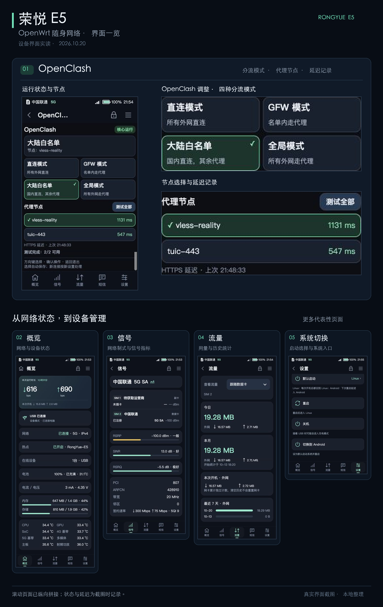
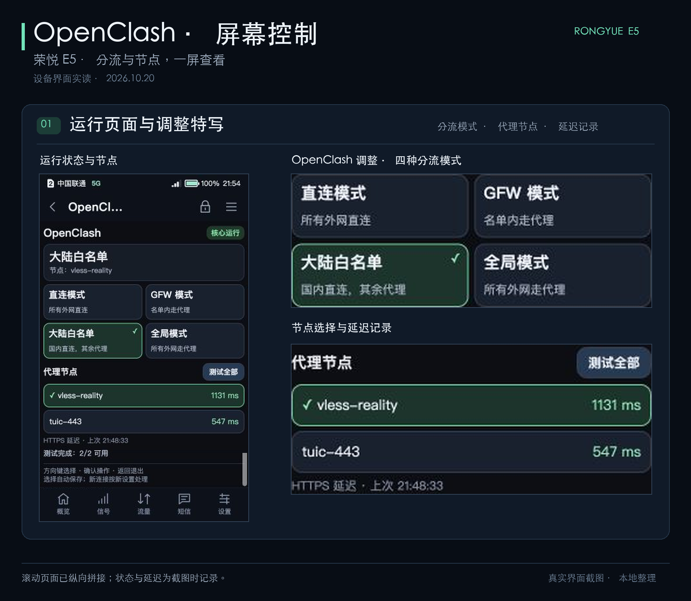

# Rongyue E5 · Portable OpenWrt Wi-Fi

[中文](README.md) · [Project introduction](docs/project-intro.en.md)

OpenWrt network management and on-device controls for the Rongyue E5: share a cellular connection over Wi-Fi, check signal and data usage, control OpenClash from the built-in screen, and switch between Android and OpenWrt.

## Features

- **Portable hotspot:** share the cellular connection with phones, computers and other devices connected to the E5's Wi-Fi.
- **Hotspot screen controls:** change the password and refresh its QR code, view clients, traffic and connection time, disconnect clients, and manage a blacklist.
- **On-device status:** view connectivity, signal strength, radio band, data usage, battery level, temperatures and memory usage.
- **OpenClash screen controls:** change routing modes, select a proxy and run manual HTTPS latency checks.
- **System switching:** reboot into Android from the OpenWrt screen, then use a Magisk module in Android to reboot back into OpenWrt.

## Control OpenClash on the device

Open **Apps → OpenClash** to see the service status, routing mode and selected proxy. Use touch or the direction and confirm keys to:

- Switch between **Direct, GFW, Mainland whitelist and Global** modes.
- Select a proxy from the list; the selection is saved and applied automatically.
- Choose **Test all** to see each proxy's HTTPS request latency and test time.

Mode and proxy changes do not require a device reboot. Latency tests run on request and do not automatically select a different proxy.

## Manage the hotspot and its clients

Open **Hotspot → Change hotspot password** and use the screen keyboard or
physical number keys. Saving refreshes the join QR code; clients must reconnect
with the new password.

Open **Hotspot → Manage clients / Blacklist** to view connected devices,
upload/download totals and rates, and connection or observation time. Counters
start after discovery, include proxy/local traffic, reset after restart, and
are not cellular billing figures. Clients can be disconnected or added to a
persistent blacklist, with an unblock control in the blacklist tab.

The current plugin is **1.0.3-local**. Its [source and integration guide](components/hotspot-screen/README.md)
list compatibility requirements, 19 host-only tests, and the deferred separate
reconnection-after-unblock device test.

## Switch between Android and OpenWrt

| Direction | Control |
| --- | --- |
| OpenWrt → Android | Built-in screen: Advanced → System → Switch to Android |
| Android → OpenWrt | Magisk → Modules → E5 System Switch · Enter OpenWrt → Action |

Switching reboots the device and interrupts its hotspot connection. Once installation is complete, routine switching needs no computer, microSD card or reflashing.

## Documentation and source

- **Project introduction:** [English](docs/project-intro.en.md) / [中文](docs/project-intro.zh-CN.md)
- **OpenClash screen plugin:** [Source, build instructions and compatibility requirements](components/openclash-screen/README.md)
- **Hotspot screen plugin:** [Password, QR code, client accounting and blacklist](components/hotspot-screen/README.md)
- **System switching:** [Usage and implementation reference](components/system-switch/README.md)
- **Development history:** [English timeline](docs/history/timeline.en.md) / [中文记录](docs/history/timeline.zh-CN.md)
- **Development source:** [Source catalog by stage](archive/CATALOG.md) · [Host tools and tests](tools/README.md)
- **Validation:** [Device tests, known issues and screenshot notes](docs/validation.md)

## Project status

This repository documents the integration and development work on one Rongyue E5. Known storage reliability issues and remaining tests are detailed in the [validation record](docs/validation.md). Published system-switching code is a sanitized implementation reference; the repository does not provide a complete firmware image or an installable switching module.

## Sources and license

The base system and screen UI build on [Enceka/e5-linux](https://github.com/Enceka/e5-linux) and [Enceka/infoscreen](https://github.com/Enceka/infoscreen). This project adds hotspot and OpenClash screen controls and device-specific system-switching integration using [OpenClash](https://github.com/vernesong/OpenClash), [Mihomo](https://github.com/MetaCubeX/mihomo) and [Magisk](https://github.com/topjohnwu/Magisk).

Original code and documentation use the [MIT License](LICENSE). Third-party works retain their own copyrights and licenses; see the [third-party notices](THIRD_PARTY_NOTICES.md) for exact versions and attribution.
