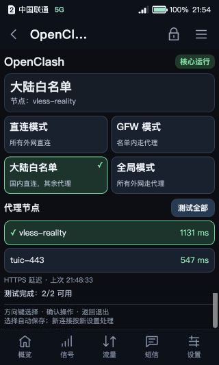

# E5 OpenClash screen plugin

已部署版本 / Device-used version: **1.1.1-local**.

该插件使用 E5 信息屏 API v2，在“应用 → OpenClash”中展示核心状态、四种分流模式、所选节点和手动 HTTPS 延迟。触摸和方向键/确认键均可操作。它调用已有 OpenClash/Mihomo 服务，不包含代理核心或节点订阅。

The plugin uses E5 infoscreen API v2 to expose service status, four routing modes, node selection, and manual HTTPS latency. Touch and directional/confirm controls are supported. It controls an existing OpenClash/Mihomo installation; it does not bundle a proxy core or subscription.



## Files

| File | Role |
| --- | --- |
| `index.html`, `app.js` | Screen UI and controls |
| `backend.uc` | Validated local API routes for the infoscreen host |
| `control.py` | Mode/node operations, persistence, validation, rollback and latency cache |
| `manifest.json` | API version, plugin version and versioned entry point |
| `build.py` | Produces a local plugin archive |
| `test_control.py`, `test_nodes.py` | Host-only tests with temporary files and fake controllers |

## Compatibility assumptions / 适配前提

- E5 infoscreen API **v2**, with the upstream `/sdk/e5.js` and plugin host already installed.
- Existing OpenClash service, Python 3.10+ on the device, Ruby YAML/Psych, UCI and Mihomo's native API.
- The managed source is `/etc/openclash/config/e5-reference.yaml`, **encoded as JSON despite the `.yaml` suffix**. JSON is valid YAML; the current Python source transformer uses `json.loads`, so arbitrary YAML source files are not supported.
- The generated runtime configuration is `/etc/openclash/e5-reference.yaml`; it is processed as YAML.
- A selector group named `PROXY`, the existing `clash_meta` binary, and the required local GeoSite/GeoIP data.
- The runtime's existing `SAFE_PATHS` is preserved during candidate validation.
- The service must already be enabled. Selecting another OpenClash source configuration disables this plugin's write controls.

本项目测试时使用 OpenClash **v0.48.002** 和 Mihomo **v1.19.32**。其他版本、任意第三方配置或不同设备不因此视为兼容。真实配置含凭据，应在设备本地配置；仓库不提供真实节点文件。

## Build and test / 主机构建与测试

Run from the repository root:

```sh
python3 -m unittest discover -s components/openclash-screen -p 'test_*.py' -v
mkdir -p dist
python3 components/openclash-screen/build.py dist
```

This creates `dist/openclash-screen-1.1.1.tar.gz` and a package manifest. It does not install anything or contact a device.

After independently confirming the compatibility assumptions and reviewing the trusted plugin code, the upstream infoscreen plugin manager accepts an archive already copied to the device:

```sh
/usr/libexec/e5-infoscreen/plugin install /tmp/openclash-screen-1.1.1.tar.gz
```

This is a plugin installation command, not an OpenWrt or OpenClash installer. Installation replaces the `openclash` plugin of the same ID. Reopen the app to load the versioned entry. The plugin backend runs with the privileges of the upstream local host; it is not intended to be exposed directly to the network.

## Behavior / 操作语义

| Mode | New connections |
| --- | --- |
| Direct / 直连 | Direct outbound traffic; the existing core and DNS remain running |
| GFW | Proxy domains in the local `gfw` GeoSite set; otherwise direct |
| Mainland whitelist / 大陆白名单 | Direct for CN domains/IPs; proxy the rest |
| Global / 全局 | `GLOBAL → PROXY → selected node` |

Local management traffic keeps the existing bypass behavior. Established connections may keep their previous route. Switching modes does not restart OpenClash or the device. Global mode can change the behavior or performance of domestic services.

Node selection is persisted in the selector default and applied through the core API. Tests measure HTTPS request latency, not throughput, and never select a different node automatically. Cached latency is held in RAM and tied to the actual node definitions.

Mode and node operations keep private pre-change backups, validate candidate configuration, and attempt rollback on failure. A lost API response is treated as potentially applied. Rollback is only reported after verification; errors remain visible.

## Attribution

Local plugin implementation: this repository, [MIT](../../LICENSE). Host interface: upstream E5/infoscreen. External services: OpenClash and Mihomo. See [third-party notices](../../THIRD_PARTY_NOTICES.md) for pinned versions and separate licenses.
