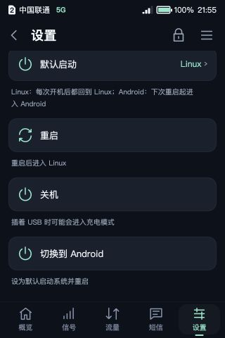

# Historical E5 system switching / 历史双系统切换方案

This directory preserves the **1.0.2-local adaptation used on 2026-10-20**, when the OpenWrt image lived in internal Android userdata and did not require a TF card. It does **not** describe the current storage layout or Android user interface. The published shell files are sanitized references, not an installable Magisk module.

本目录保留 2026-10-20 的内部镜像方案。**当前 OpenWrt 运行依赖已适配的 TF 卡**；Android 日常返回入口位于原电源菜单下方，Magisk Action 保留为另一入口。当前实现请看 [Android 菜单与进度组件](../android-system-switch-ui/README.md)、[TF 启动与切换组件](../tf-system-switch/README.md)，使用方式见[中文说明](../../docs/tf-system-switch.zh-CN.md) / [English guide](../../docs/tf-system-switch.en.md)。

The current OpenWrt deployment requires its provisioned TF card. Its Android return entry appears below the original power menu, with Magisk Action retained as an alternative. Use the current component links and guides above for that deployment.

## Historical user flow / 当时的使用方式

- **OpenWrt → Android:** on the E5 screen, open **高级 → 系统 → 切换到 Android** and confirm the reboot. The authenticated web interface also provides a switch action.
- **Android → OpenWrt:** boot and unlock Android, then open **Magisk → 模块 → E5 系统切换 · 进入 OpenWrt → 操作**.
- In that deployment, OpenWrt was the default. An intentional switch to Android kept Android selected; returning through the local Magisk action restored OpenWrt as the default.
- “Linux” in the upstream screen means OpenWrt in this installation. Hotspot connectivity is interrupted during switching and recovers after boot and cellular initialization.

旧方案完成安装后的日常切换无需电脑、TF 卡或重新刷镜像；这一描述仅适用于历史内部镜像布局。当前方案日常切换仍无需电脑或重新刷镜像，但必须保留 TF 卡。首次安装、恢复故障和为另一台设备建立基线属于另外的工作。

## Historical checks / 历史实现检查

The historical Android action checked device identity, storage identity, the current Android slot, boot-control format/CRC, partition geometry, protected boot-chain digests, the installed OpenWrt image, and filesystem-error indicators. It backed up boot control, called the pinned upstream `e5-bootctl`, checked the permitted write range, synchronized and froze data before the established reboot path.

Failure cleanup tries to restore the original **32-byte region at `misc + 2048`** and verifies the complete expected boot-control state. The module adds no boot-time action hooks and does not install a firmware image or sync the Android boot chain.

上述地址和检查是本机方案的历史实现描述，不是为所有 E5 确认过的刷写参数。后续因内部存储路径故障复发改用 TF 根系统；迁移不等于证明所有历史故障或偶发断网已根治。

## Public source boundary

`reference/switch.sh`, `action.sh` and `customize.sh` preserve the source structure but exit with status **64 before any device access**. Real serial/CID values, device-specific hashes and the image inode have been replaced by unset markers. The private `protected.sha256`, executable helper and installable ZIP are omitted.

The empty `.example` files are documentation, not sufficient provisioning inputs. Removing the stop guard or copying another device's values would not reproduce the original validation. No automatic binding or flashing utility is provided here.

The publication check executes only the early-stop behavior and checks shell syntax. Historical device tests are documented separately in [validation](../../docs/validation.md).

## Upstream

Boot-control helper and base switching design: [Enceka/e5-linux, commit `569f13d4ce15585f70817c2a1e03bb574a84720b`](https://github.com/Enceka/e5-linux/tree/569f13d4ce15585f70817c2a1e03bb574a84720b/magisk), MIT.

The helper binary used in this **historical 1.0.2 deployment** was unchanged from upstream; the later TF helper has separate adaptations. Magisk is an external runtime, not bundled here. The E5 screen-side switch entry belongs to the upstream firmware; the historical local adaptation described here provided the Android-side action and additional checks. See [third-party notices](../../THIRD_PARTY_NOTICES.md).
