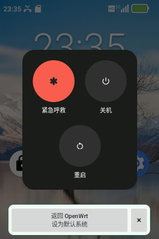

# Rongyue E5: network controls on the built-in screen

[中文](project-intro.zh-CN.md) · [Project home](../README.en.md)

This project brings a portable cellular hotspot, screen-based network controls and system switching together on the Rongyue E5. The screen shows signal and data usage and directly controls OpenClash routing modes, proxy selection and HTTPS latency checks. OpenWrt runs from a TF card while Android remains on internal storage. Both systems are accessible through on-device controls and a reboot.

## Network status and hotspot controls

The overview shows connectivity, hotspot state, traffic rates, battery, memory and temperatures. The signal page shows network technology, radio band and signal measurements; the traffic page shows daily, monthly and historical usage.

Hotspot controls change the password and refresh the QR code, display connected clients, upload/download totals and rates, and connection or observation time, and support disconnecting, blocking and unblocking clients. Saving a new password reinitializes the radio, so clients must reconnect. Client counters start after discovery, include local and proxy traffic, reset on restart, and do not replace cellular billing records.

## Control OpenClash from the screen

Open **Apps → OpenClash** and use touch or the direction and confirm keys to change modes, choose a proxy and run a manual latency test. Mode and proxy selections are saved and applied without rebooting the device.

| Mode | Routing behavior |
| --- | --- |
| Direct | Connect directly without using a proxy |
| GFW | Proxy requests matching the GFW domain list; connect directly otherwise |
| Mainland whitelist | Connect directly for China domain or IP rules; proxy the rest |
| Global | Use global proxy mode through the selected proxy |

GFW and Mainland whitelist modes send local-domain and private-network requests directly first. **Test all** displays each proxy's HTTPS request latency and test time. It compares responses to a probe address and does not automatically select a different proxy.

*Device screen captures, with scrolling content stitched vertically.*

## Android and OpenWrt on the same device

Choose **Advanced → System → Switch to Android** on the OpenWrt screen to reboot into Android. To return, hold Android's power button, choose **Return to OpenWrt / Set as default** below the original menu, and confirm. The checks are followed by an automatic reboot. Once the return completes, ordinary reboots default to OpenWrt.

The progress page shows actual stages and elapsed time; closing and reopening it displays the same task. Routine switching needs no computer or reflashing, but OpenWrt depends on the provisioned TF card. Validation can take several minutes; one return took about 11 minutes. Keep power connected and wait for the automatic reboot, without repeated submissions or a manual restart.

## Project and open-source information

The project builds on [Enceka/e5-linux](https://github.com/Enceka/e5-linux) and [Enceka/infoscreen](https://github.com/Enceka/infoscreen), using OpenClash, Mihomo and Magisk. It adds screen controls, TF boot integration and an Android power-menu entry. The repository includes source, development history and sanitized references. Public boot and switching scripts refuse device operations by default; this is not a universal flashing package.

Original project code and documentation use the [MIT License](../LICENSE); upstream components retain their own licenses. See [third-party sources](../THIRD_PARTY_NOTICES.md), the [usage and architecture guide](tf-system-switch.en.md), and [validation](validation.md) for completed tests, historical faults and remaining work. Long-term operation and a fresh phone-hotspot test remain separate validation tasks.
