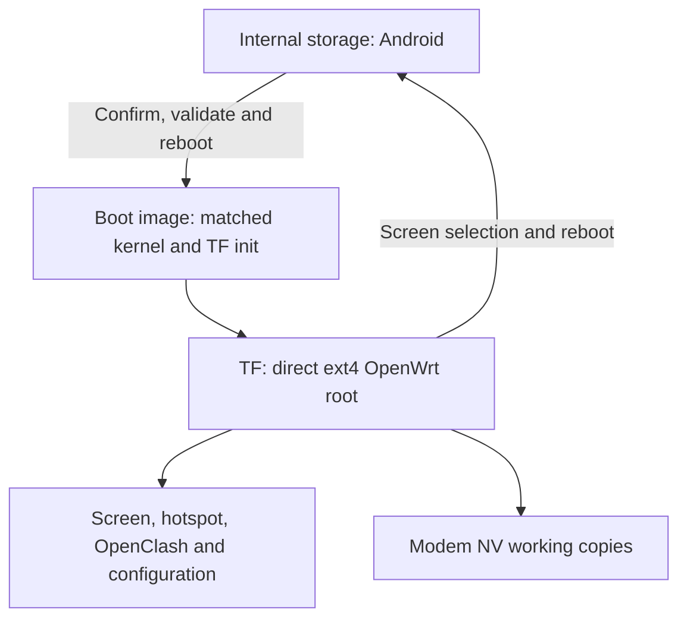

# TF root filesystem and system switching

[中文](tf-system-switch.zh-CN.md) · [Project home](../README.en.md)

The current deployment places OpenWrt on a separate ext4 partition on a TF (microSD) card. Android remains on internal storage. TF migration and switching in both directions have device evidence. This guide describes the deployed device and its architecture; it is not an installation procedure ready for another E5.

## Daily use

| Action | Control and result |
| --- | --- |
| OpenWrt → Android | **Advanced → System → Switch to Android**. Confirm to reboot; ordinary Android reboots continue to stay in Android |
| Android → OpenWrt | Hold power → **Return to OpenWrt / Set as default** below the original menu → confirm. Successful checks lead to an automatic reboot and restore the OpenWrt default |
| View progress | Actual stage and elapsed time are shown; return to the home screen and reopen the app to view the same task |
| Cancel confirmation | Choose to stay in Android in the confirmation dialog; no task is submitted |
| Error or unknown state | Keep the device powered, copy the stage, task ID and exit code for diagnosis; do not resubmit or manually reboot |

**Keep the TF card inserted and maintain power during switching.** One return through the new UI took about **10 minutes 47 seconds** from confirmation to the reboot disconnect. Network initialization takes additional time. This is an observation, not a guaranteed deadline. Closing the page after submission does not cancel the task.

The entry can be disabled in Android accessibility settings or removed by uninstalling the app. It does not replace SystemUI. Initial setup requires the user to enable the menu service, grant this app Magisk root access, and allow progress notifications. The entry and grants persisted through an ordinary Android reboot; the app does not automatically submit work at boot.

The Magisk module's **Action** remains an alternative entry and performs the same full checks before automatic reboot. For maintenance, `action.sh check` uses the private mount-namespace wrapper; do not bypass it by directly calling `switch.sh`. Public reference scripts are not an installable package for the deployed device.

## TF layout and protection boundaries

- The former layout kept an OpenWrt image inside Android userdata. Normal OpenWrt boot now mounts the TF root directly and does not boot that old internal image.
- Firmware, runtime dependencies, screen plugins, configuration and NV working copies are provided by the TF root. Normal TF boot keeps Android userdata kernel-read-only and unmounted. Physical NV remains read-only; the modem uses separate working copies.
- The kernel and modules are paired. Boot checks storage identity, partition geometry, binding and a critical-file manifest. The deployed manifest contains 1,830 immutable files; mutable configuration and NV contents are not frozen by static content hashes.
- TF-specific guards restrict existing automatic block-device scanning paths so normal startup and shutdown do not remount old userdata. This does not prohibit every storage-probing command an administrator might deliberately run.
- Switching checks identity, occupancy, images and protected regions, then backs up and reads back boot control before the established synchronization and reboot sequence. The new UI does not bypass a missing card or failed checks. Recovery to Android after every possible boot failure is not guaranteed.

## Android menu and background task

The app matches only the unlocked SystemUI power menu and adds an entry below it. An explicit click closes that menu and opens a confirmation page. External intents, notification clicks and service startup cannot submit a switch directly.

Confirmation invokes the local module through fixed `start / status / stream` operations. A separate background task holds the operation lock; progress observation is independent, allowing the page to close and reopen. At most one UI task is submitted per Android boot. A lost response or unknown state permits only reading status again, not automatic resubmission. “Rebooting” or a lost connection does not itself prove that OpenWrt has booted.

New runtime logs and status live in a memory filesystem, adding no logging writes after Android data has been frozen. The UI can copy the stage, task ID and exit code. Full errors remain available to a maintainer; reboot clears this memory log.

## Versions, validation and public source

This deployment uses OpenWrt `25.12.5`, kernel `6.18.54-e5-mobile4-tfmmc1`, screen `1.6.7`, OpenClash `0.48.002`, Mihomo `1.19.32`, OpenClash screen plugin `1.1.1-local`, hotspot plugin `1.0.3-local`, Android app `1.0-local` and local switch module `1.1.3-tf-local`.

The kernel uses [sprd-linux-devs/linux `020b970`](https://github.com/sprd-linux-devs/linux/commit/020b970e351eee3887e6caaf2d653926e7086e44), retains the local `mobile4` board changes, and backports the complete upstream storage commit [`33c01a9`](https://github.com/sprd-linux-devs/linux/commit/33c01a9e7d2f58dd1c09a33f69ea82dd71281616). These Linux changes retain upstream and contributor ownership under GPL/per-file SPDX terms; they are outside the MIT licensing scope of this project's boot scripts.

The complete kernel build, board changes and storage-correction patches are outside this selected core source export. This repository does not provide a complete reproducible firmware distribution; see [third-party sources and scope](../THIRD_PARTY_NOTICES.md).

Real UI confirmation, cancellation, close/reopen, persistence across an ordinary Android reboot and automatic return to TF were validated. The returned system's default target, critical files, OpenClash configuration, screen/hotspot services and device/USB-client HTTPS were checked. Initial tests failed about one minute into boot while WAN/DNS were not ready; services were ready around two minutes and retests passed. Those initial failures remain recorded. Fresh physical-touch, phone Wi-Fi and long-term stability acceptance remain separate; see [validation](validation.md).

- [Android app and backend reference](../components/android-system-switch-ui/README.md)
- [TF boot and switching reference](../components/tf-system-switch/README.md)
- [Historical installation without a TF card](../components/system-switch/README.md)
- [Sources and licenses](../THIRD_PARTY_NOTICES.md)

Public device entry points refuse execution by default. Device bindings, protected digests, private configuration, firmware and flashable materials are excluded. Reading the code or passing host tests does not provision or validate another device.
