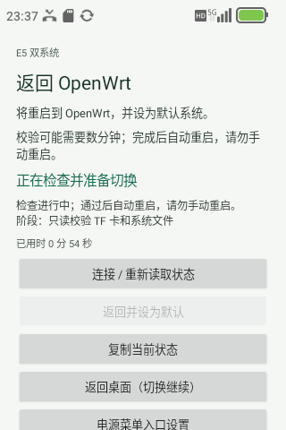
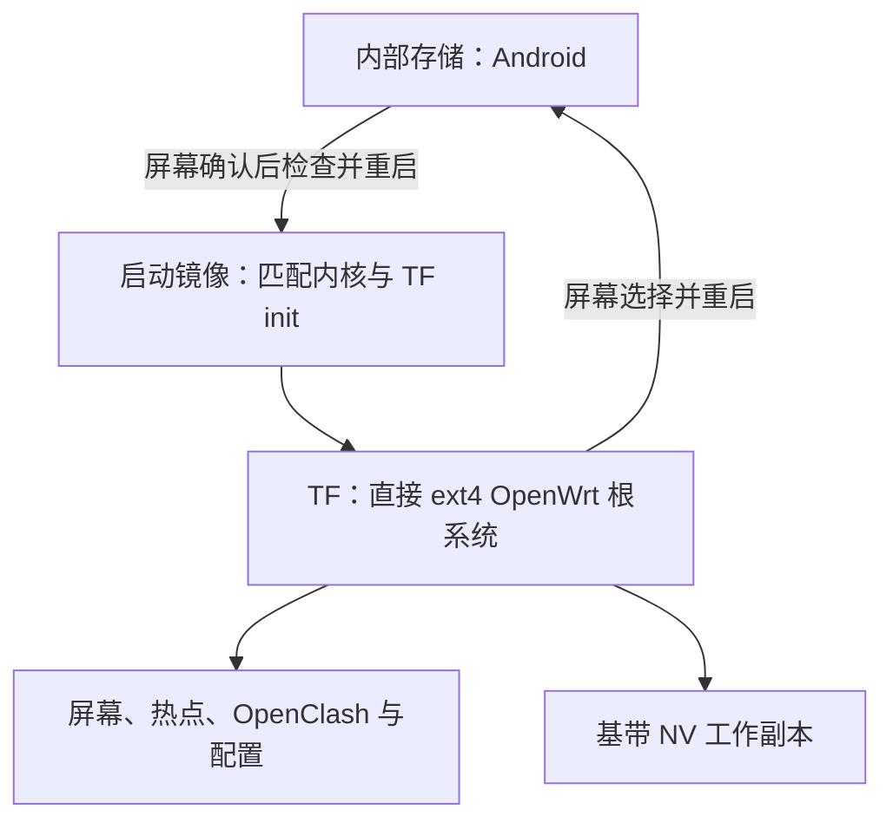

# TF 根系统与双系统切换

[English](tf-system-switch.en.md) · [项目首页](../README.md)

当前部署把 OpenWrt 放在独立 TF（microSD）卡的 ext4 分区上，Android 留在内部存储。TF 迁移和双向启动已有实机验证；本页说明已部署设备的使用方式与架构，不是为其他设备直接执行的安装教程。

## 日常使用

| 操作 | 入口与结果 |
| --- | --- |
| OpenWrt → Android | **高级 → 系统 → 切换到 Android**。确认后重启，普通 Android 重启继续留在 Android |
| Android → OpenWrt | 长按电源键 → 原菜单下方的 **返回 OpenWrt / 设为默认系统** → **确认返回**。检查通过后自动重启，并恢复 OpenWrt 默认 |
| 查看进度 | 页面显示阶段与实际已用时间；返回桌面后可重新打开“返回 OpenWrt”，查看同一任务 |
| 取消确认 | 在确认框选择留在 Android，不提交切换任务 |
| 错误或状态未知 | 保持开机，复制当前阶段、任务标识和退出码，交由维护者检查；不要重复提交或手动重启 |

**保持 TF 卡插入，切换期间持续供电。** 本机新入口一次返回从确认到重启断连约 **10 分 47 秒**；进入系统后网络仍需初始化。这是一次观察，不是承诺时限。任务开始后，关闭页面不是取消操作。

界面可在 Android 无障碍设置中停用，也可卸载应用；它不替换厂商 SystemUI。初次设置需要用户启用菜单服务、授予本应用 Magisk root 权限及进度通知权限。普通 Android 重启后，入口和授权已验证保留，应用不会在开机时自动提交切换。

Magisk 模块的 **操作 / Action** 保留为另一入口，也会执行完整检查并等待自动重启。高级维护中的 `action.sh check` 经过私有挂载命名空间包装；不要绕过包装直接调用底层 `switch.sh`。公开仓库中的参考脚本不能作为本机安装包使用。

## TF 布局与保护边界

- 旧方案使用 Android userdata 中的 OpenWrt 镜像；当前正常 OpenWrt 启动直接挂载 TF 根系统，不再从旧内部镜像启动。
- 固件、运行依赖、屏幕插件、配置和 NV 工作副本随 TF 根系统提供。Android userdata 在正常 TF 启动中保持内核只读，且不挂载；物理 NV 保持只读，基带使用独立工作副本。
- 内核与模块配对，启动前检查存储身份、分区几何、绑定和关键文件清单。当前本机清单包含 1,830 项不变文件；可变配置和 NV 内容不按静态文件哈希锁死。
- 已有自动块设备扫描入口作 TF 专用限制，避免正常启动和关机流程重新挂载旧 userdata。此范围不等同于禁止管理员主动执行任何存储探测命令。
- 切换先检查身份、占用、镜像与保护链，再保存和读回启动控制，按既有顺序同步并重启。缺卡或校验失败不会通过新 UI 绕过检查；本项目不承诺任意启动故障都能自动恢复 Android。

## Android 菜单与后台执行

应用只匹配已解锁的 SystemUI 电源菜单，在下方添加入口。明确点击后关闭该菜单并打开确认页；外部 Intent、通知点击和服务启动都不能直接提交切换。

确认后通过固定的 `start / status / stream` 接口调用本机模块。独立后台任务持有操作锁；进度观察与任务执行分离，关闭页面后可重新查看。每次 Android 启动最多提交一个 UI 任务；响应丢失或状态未知只重新读取状态，不自动重试。显示“正在重启”或连接中断本身不代表已经进入 OpenWrt。

新增运行日志与状态保存在内存文件系统中，不增加 Android 数据分区冻结后的日志写入。界面可复制阶段、任务标识和退出码；完整错误仅留给维护者读取，重启会清除这份内存日志。

## 版本、验收与公开源码

本次部署使用 OpenWrt `25.12.5`、内核 `6.18.54-e5-mobile4-tfmmc1`、屏幕 `1.6.7`、OpenClash `0.48.002`、Mihomo `1.19.32`、OpenClash 屏幕插件 `1.1.1-local`、热点插件 `1.0.3-local`、Android 应用 `1.0-local` 和本机切换模块 `1.1.3-tf-local`。

内核以 [sprd-linux-devs/linux `020b970`](https://github.com/sprd-linux-devs/linux/commit/020b970e351eee3887e6caaf2d653926e7086e44) 为基线，保留本地 `mobile4` 板级改动，并定向回补完整上游存储提交 [`33c01a9`](https://github.com/sprd-linux-devs/linux/commit/33c01a9e7d2f58dd1c09a33f69ea82dd71281616)。这些 Linux 改动按 GPL/各文件 SPDX 归属上游及相应贡献者，不适用本项目 MIT 启动脚本的授权范围。

完整内核构建、板级改动和存储修正补丁不在本次核心参考源码导出中。本仓库不提供完整可复现固件，见[第三方来源与范围](../THIRD_PARTY_NOTICES.md)。

真实 UI 确认、取消、关闭重开、Android 普通重启保持和自动返回 TF 已验证。返回后默认目标、关键文件、OpenClash 配置、屏幕/热点服务及设备与 USB 客户端 HTTPS 已核对。首次开机约一分钟时 WAN/DNS 尚未就绪，检查失败；随后约两分钟就绪并复测成功，原失败记录保留。新一轮实体触摸、手机 Wi-Fi 客户端和长期稳定性没有因此自动通过，见[验证记录](validation.md)。

- [Android 应用与后台参考](../components/android-system-switch-ui/README.md)
- [TF 启动与切换参考](../components/tf-system-switch/README.md)
- [历史无 TF 方案](../components/system-switch/README.md)
- [来源与许可证](../THIRD_PARTY_NOTICES.md)

公开设备入口默认拒绝执行；设备绑定、保护哈希、私有配置、固件与可刷写材料不随本仓库发布。阅读源码或通过主机测试，不等于完成另一台设备的部署与验收。
